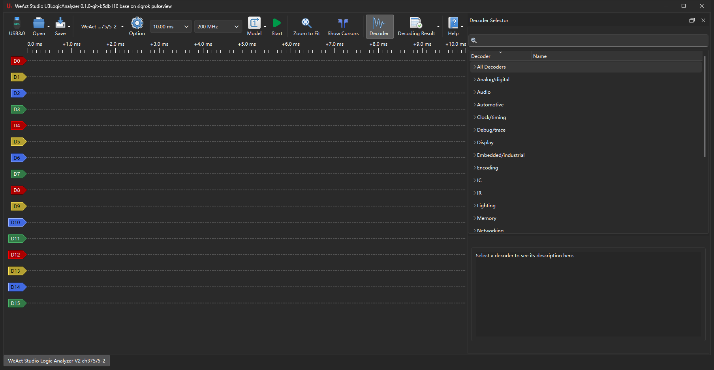
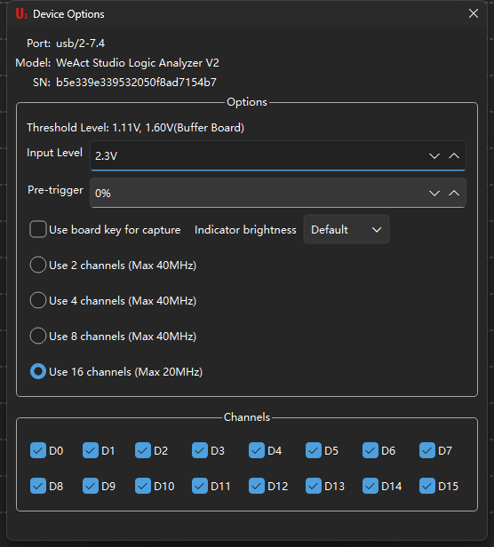
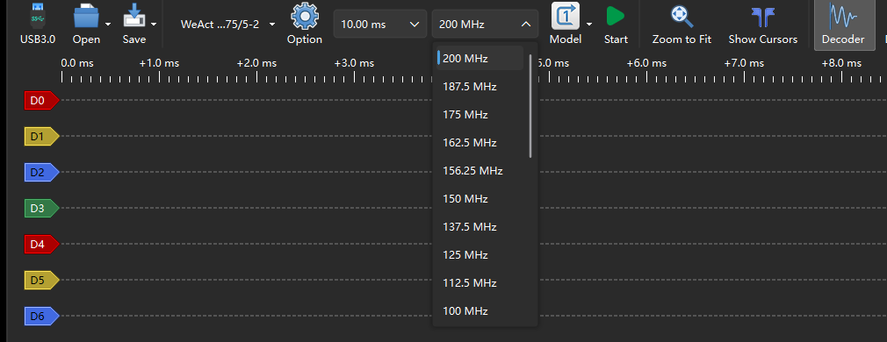
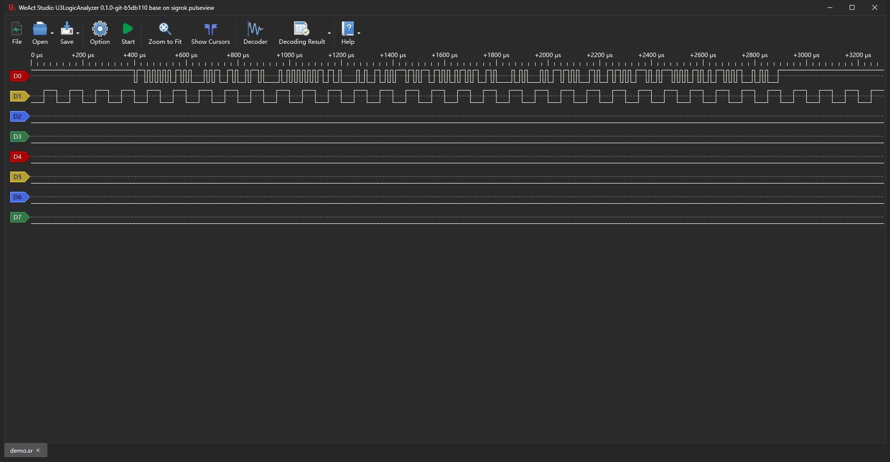

# Using U3LogicAnalyzer

[中文](usage.zh_CN.md) · [Back to README](../README.md)

This guide covers the everyday use of U3LogicAnalyzer: connecting a device, capturing, reading the waveform, adding protocol decoders and saving the result.



## Window layout

| Area | Contents |
|---|---|
| Tool bar | Open / Save / device selector / device options / capture length / sample rate / capture mode / start / zoom to fit / measure / decoder / decoding result / export |
| Waveform view | One row per channel, channel labels on the left, time axis on top |
| Protocol decoder panel | Search box, decoder tree and the description of the selected decoder |
| Tab bar (bottom) | One tab per session: one device or one file |
| Status bar | Device name and connection id, e.g. `ch375/5-2` |

The interface follows the system language. To select one manually: Help → Settings → "User interface language"; the choice applies immediately.

## Connecting a device

The application scans for devices as soon as one is plugged in, and the device selector shows the model and port, e.g. `WeAct Studio Logic Analyzer V2 ch375/5-2`.

- **One device**: it is the only entry in the list; start capturing directly.
- **Several devices**: the list holds one row per port. Each row offers "open in a new session", so every device can capture into a session of its own at the same time.
- **Hot plug**: unplugging a capturing device leaves that page behind an offline mask, and no capture can be started there until the device is reconnected. Plugging or unplugging other devices during a capture does not affect the device being captured.

On Windows the CH375DLL driver is the default. From firmware version 0.2 (`sw=0x02` in the `0xAC` reply), the device carries a Microsoft OS descriptor, so a computer without the CH375 driver binds WinUSB automatically and no manual rebinding is needed. On a computer with the CH375 driver already installed, CH375DLL is still used and no change is necessary. Earlier firmware and FX2-based analyzers still need a WinUSB rebind with Zadig; see the README of the U3LogicAnalyzer repository.

## Device options

The device options button (gear icon) on the tool bar opens the device options panel:



| Item | Description |
|---|---|
| Threshold level | Range of the high/low decision; follows the input level |
| Input level | Voltage of the signal under test, 1.0–3.3 V. **It must match the level actually applied**: select 3.3 V for 3.3 V logic |
| Pre-trigger | Share of the capture window reserved for the time before the trigger (0–100%); see Capturing |
| Channel count | 2 / 4 / 8 / 16 channels. **With 8 channels** each sample takes one byte, so the same memory holds twice as many samples |
| Channel boxes | Channels that take part in the capture (affects display and decoding only; the data is still packed by channel count) |
| Use the board key to start/stop capture | When selected, short-press KEY to start and stop capture; a two-second press still switches firmware slots. Requires firmware 0.2 and U3LogicAnalyzer 0.2.0.0 or newer |
| Indicator brightness | Dim / Default / Bright / Brighter / Maximum, with Default selected initially. Requires firmware 0.2 and U3LogicAnalyzer 0.2.0.0 or newer |

A wrong input level places the threshold incorrectly: set too high, genuine highs read as low; set too low, noise reads as high.

> Changing the channel count rebuilds the table of available sample rates. This reflects the device itself rather than an application defect: settle the channel count first, then select the rate.

## Sample rate and capture length

- **Sample rate**: 25 steps from 4 MHz to 200 MHz on a USB 3.0 link; the table follows the link and the channel count (4–20 MHz at 16 channels and 4–40 MHz at 8 channels on USB 2.0).
  
- **Capture length**: from 10 ms. The software uses an 18 GB data figure to define the length ceiling (samples = rate × time, 2 bytes per sample at 16 channels): about 45 s at 200 MHz / 16 channels, 90 s at 8 channels (the actual length is limited by free PC memory).

Rules of thumb:

| Use case | Rate | Duration |
|---|---|---|
| UART / I²C / SPI and other slow buses | At least 5× the baud rate or clock; 10–50 MHz is usual | Long enough for the message |
| Fast parallel buses | 100–200 MHz | As short as possible; keep memory use in view |
| Slow level changes | 4–10 MHz | A few seconds |

## Capturing

Press Start on the tool bar, or the space bar, to begin; press again to stop. When the capture ends, the view zooms to fit the data.

- **Mode → Single**: stops once the configured number of samples has been collected.
- **Mode → Repeat**: captures continuously until stopped; each round replaces the previous one.
- **Pre-trigger**: at 50%, half of the window holds samples from before the trigger and the rest samples after it. The device has no hardware trigger unit; the setting divides the capture window, which is what reveals the state preceding an event.
- **Long captures**: all data stays in memory. The application checks free memory while data arrives and stops the capture below 512 MB with a message, keeping the data already captured. Fewer channels, a lower rate or a shorter duration allow a longer capture.

## Reading the waveform

| Action | Procedure |
|---|---|
| Zoom the time axis | Scroll the mouse wheel over the waveform view, or use Zoom to Fit for the whole capture |
| Scroll | Drag the waveform, or use the scroll bar |
| Measure | The Measure button opens two cursors; drag them to read the time difference and frequency |
| Channel actions | Right-click a channel label to rename it, show or hide it, or change its height |
| Sample markers | The view options can draw sample points, which shows how dense the sampling is |

## Protocol decoders

The decoder button (or `D`) opens the panel on the right:

1. Type a protocol name into the search box, e.g. `uart`, `i2c` or `spi`.
2. Open a category, or double-click the decoder in the search results.
3. In the configuration dialog, assign the channels and set the options (the RX channel and baud rate for UART, for instance), then confirm.
4. The decoded rows appear below the waveform; Decoding Result switches to a list view of them.

A session can stack several decoders, for example SPI flash commands and data on one bus. There are 132 decoders; the full list is in the `decoders` folder of the installation directory (e.g. `C:\Program Files\WeAct Studio\U3LogicAnalyzer\decoders`).

Decoded results can be exported: the Export button writes several text formats, and "Export to a New Session" copies the waveform and its decoders into a new tab, which leaves the original capture unchanged.

## Saving and exporting

- **Save / Save As**: a sigrok session file (`.sr`, a zip container) holding channel data and the sample rate. An 8-channel capture stays 8 channels wide and is not read back as 16.
- **Save Selected Range As**: only the samples in the current view.
- **Save Session Setup**: the configuration only (device options, decoders, view), without data.
- **Open**: from the menu, or on the command line:

```bash
./U3LogicAnalyzer capture.sr        # Windows: U3LogicAnalyzer.exe capture.sr
./U3LogicAnalyzer -i capture.sr
```

Opening a file builds the session from the channels it actually holds: only those channels get a row, and the channel dialog lists those alone.



## Sessions and multiple devices

- The tab bar at the bottom holds several sessions at once: one per device, or one per `.sr` file.
- The first session cannot be closed, and opening a file always adds a tab.
- "Export to a New Session" copies the result into a tab of its own; the capture it came from stays unchanged.
- Closing the last file tab restores the device session.

## Firmware update

Help menu → **FW Update**.

- The update runs over the device IAP. The tab cannot be closed while it runs, so an interrupted write still has a tab from which to retry.
- Progress is shown on the page; the device reconnects and is read again when the update finishes.
- Do not unplug the device during the write. A failed update can be retried while the device is still in IAP mode.

## Agent configuration

The installer ships two command-line components, installed only when selected; both reside in the installation directory. The default is `C:\Program Files\WeAct Studio\U3LogicAnalyzer` and can be changed during setup; `<INSTALL_DIR>` below stands for the actual path.

| Component | Purpose |
|---|---|
| `sigrok-cli.exe` | The sigrok command-line front end, which performs device scanning, capture and protocol decoding |
| `sigrok-mcp-server.exe` | Wraps the common operations as tools for an agent and calls `sigrok-cli` internally |

> **MCP is not required.** Scanning, capture and decoding each take a single `sigrok-cli` command; `sigrok-mcp-server` only wraps those operations as tools for clients that support MCP. With sigrok-cli alone selected during installation, the command-line usage below still applies.

### Calling sigrok-cli directly

An agent only needs the ability to run commands; no further configuration is involved, and the same commands can be run by hand in a terminal.

Calling `sigrok-cli` by name requires the installation directory on PATH. To add it, open System Properties → Advanced → Environment Variables, edit the user variable `Path`, and add the actual installation directory (default `C:\Program Files\WeAct Studio\U3LogicAnalyzer`).

PATH can be left alone and the full path used instead. It contains spaces, so PowerShell needs the call operator `&` together with quotes:

```powershell
& "C:\Program Files\WeAct Studio\U3LogicAnalyzer\sigrok-cli.exe" --scan
```

The commands below follow the same pattern: replace the leading `sigrok-cli` with that full-path form, using the actual installation directory.

```bash
sigrok-cli --scan
sigrok-cli -d wch-ch32h417 -c samplerate=4m --samples 2000 -o capture.sr
sigrok-cli -i capture.sr -P uart:rx=D0:baudrate=115200 -A uart=rx-data
```

| Option | Description |
|---|---|
| `--scan` | Lists the devices and returns a driver identifier with a connection string, e.g. `wch-ch32h417:conn=ch375/4-2` (CH375DLL) or `wch-ch32h417-libusb:conn=usb/2-2.3` (libusb); the port follows the USB port, so the scan has to be repeated after the device is moved |
| `-d` | Selects the driver; take the identifier from `--scan`: `wch-ch32h417` for the CH375DLL backend and `wch-ch32h417-libusb` for the libusb one, while a mismatch reports `No devices found.` With several devices of the same model connected, the full connection string addresses one of them |
| `-c` | Sets the sample rate, which must be one of the rates supported by the driver (25 steps from 4 MHz to 200 MHz, listed by `--show`); any other value reports `Failed to set device option 'samplerate': invalid argument.` |
| `--samples`, `--time` | The former sets the number of samples, the latter a capture duration in milliseconds |
| `-o` | Writes a sigrok session file (`.sr`, a zip container) in the same format as the Save command of the application, which can be opened directly |
| `-P`, `-A` | The former selects the decoders and their options, the latter the annotations to display |

The scan also lists a `demo` device, the built-in demonstration driver of sigrok that corresponds to no hardware.

Hand the commands above to the agent, provided the client is allowed to execute commands. The command does not have to be written out in full; describing the task is enough:

- "List the connected logic analyzers."
- "Capture 1 s at 50 MHz and save it to `D:\cap\uart.sr`."
- "Decode `uart.sr` as UART with RX on D0 at 115200 baud, and paste the result."

The agent turns the third request into a command such as `sigrok-cli -i uart.sr -P uart:rx=D0:baudrate=115200 -A uart=rx-data`; the channels and options of a decoder can be looked up with `--show`, or the agent can check them itself. This route is not bound by `SIGROK_TIMEOUT_SECONDS`; the limit is whatever the client allows a command to run, and a failure has to be diagnosed from the stderr text.

### Calling through the MCP server

The server wraps the operations above as tools, and clients register it in the same shape: an executable, its arguments and its environment, with `command` pointing at `sigrok-mcp-server.exe` and `env` giving the location of `sigrok-cli`. Replace `<INSTALL_DIR>` with the actual path, and note that backslashes in JSON are written as `\\`:

```json
{
  "mcpServers": {
    "sigrok": {
      "command": "<INSTALL_DIR>\\sigrok-mcp-server.exe",
      "args": [],
      "env": {
        "SIGROK_CLI_PATH": "<INSTALL_DIR>\\sigrok-cli.exe",
        "SIGROK_TIMEOUT_SECONDS": "600",
        "SIGROK_WORKING_DIR": "<INSTALL_DIR>\\workdir"
      }
    }
  }
}
```

| Field | Description |
|---|---|
| `command` | Full path of `sigrok-mcp-server.exe` |
| `args` | Startup arguments; empty here |
| `SIGROK_CLI_PATH` | Full path of `sigrok-cli.exe`. The server calls sigrok through it, so the installation directory does not have to be added to PATH |
| `SIGROK_TIMEOUT_SECONDS` | Timeout of a single operation in seconds; increase it for long captures |
| `SIGROK_WORKING_DIR` | Working directory for temporary files such as captured data; it must be created in advance (the `workdir` folder of the installation directory in the example) |

> When `SIGROK_CLI_PATH` is not set, the server falls back to looking up `sigrok-cli` through PATH; if neither resolves, the tools return
> `sigrok-cli execution failed: exec: "sigrok-cli": executable file not found in %PATH%`.

- The `mcpServers` object together with the `command`, `args` and `env` keys is the common MCP convention; a few clients name the top-level key differently (VS Code uses `servers`), and additional keys such as `disabled` follow the documentation of the client.
- The configuration file location depends on the client: WorkBuddy uses `%USERPROFILE%\.workbuddy\mcp.json` and requires the server to be trusted under Connectors → Custom connectors; Claude Desktop uses `%APPDATA%\Claude\claude_desktop_config.json`; Cursor uses `%USERPROFILE%\.cursor\mcp.json`; other clients follow their own documentation. Create the file if it does not exist, merge the entry into `mcpServers` if it does, and restart the client afterwards.

Once the configuration is in place, describe the task in the conversation; the tool names do not have to be remembered. The following order is a reasonable start:

1. **Check the device**: ask to list the connected logic analyzers. The result should include the model and port, e.g. `CH32H417 WeAct Studio Logic Analyzer V2 with 16 channels: D0 … D15`.
2. **Capture a short run**: ask for 2000 samples at 4 MHz, saved as `test.sr`. At 4 MHz that is 0.5 ms of data and only serves to prove the link; the file lands in `SIGROK_WORKING_DIR` by default, and a successful capture returns its name, e.g. `{"file":"test.sr"}`.
3. **Capture and decode for real**: ask for 1 s at 50 MHz saved to `D:\cap\uart.sr`, or for `uart.sr` to be decoded as UART with RX on D0 at 115200 baud. The decoded result is returned as text.

Two points to keep in mind:

- Give the sample rate as one of the supported steps (4 MHz, 8 MHz, 20 MHz and so on); a rate outside that list, 1 MHz for instance, fails, so the agent may have to look up the steps of the driver first.
- The resulting `.sr` file can be dragged into the application window for viewing.

The tools that `sigrok-mcp-server` exposes to the agent are listed below; they exist only once MCP is configured. The "Command-line equivalent" column shows what each tool actually runs, which helps when comparing it with the commands above or locating the step that failed.

| Tool | Command-line equivalent | Purpose |
|---|---|---|
| `scan_devices` | `--scan` | Scans the devices and returns the driver identifier and connection string |
| `list_supported_hardware`, `show_driver_details` | `-L`, `--show` | Lists the drivers, or shows the options and sample rates of one driver |
| `capture_data` | `-d`, `-c`, `--samples`/`--time`, `-o` | Captures data to a file |
| `decode_protocol` | `-i`, `-P`, `-A` | Decodes a captured file |
| `list_supported_decoders`, `show_decoder_details` | `-L`, `--show` | Lists the decoders, or shows the channels and options of one |
| `list_input_formats`, `list_output_formats` | `-L` | Lists the supported data formats |
| `check_firmware_status`, `show_version` | `-V` | Checks that the firmware files are in place, and reports the component versions |
| `get_device_profile`, `serial_query` | — | Intended for serial and SCPI devices; rarely needed with the analyzer |

## Troubleshooting

**The device is not in the device list**
- Windows: make sure no other program holds the device; firmware older than 0.2 and FX2-based devices need a WinUSB rebind with Zadig first.
- Linux: `lsusb` lists the device but the application does not. This is a permission problem: run `sudo ./install_udev_rules.sh` and reconnect the device.

**The capture stops at once with 0 samples**
- The sample rate exceeds what the link supports, or the sample count is too large. Lower the rate or shorten the duration and try again.
- The device may still be held by a previous program: unplug and reconnect it.

**The interface is in English**
- The language was set manually. Go to Help → Settings → "User interface language" and select the required language.

**A low-memory notice appears at startup**
- The application checks free memory at startup and asks for confirmation below 4 GB. Close some programs or confirm to continue.
