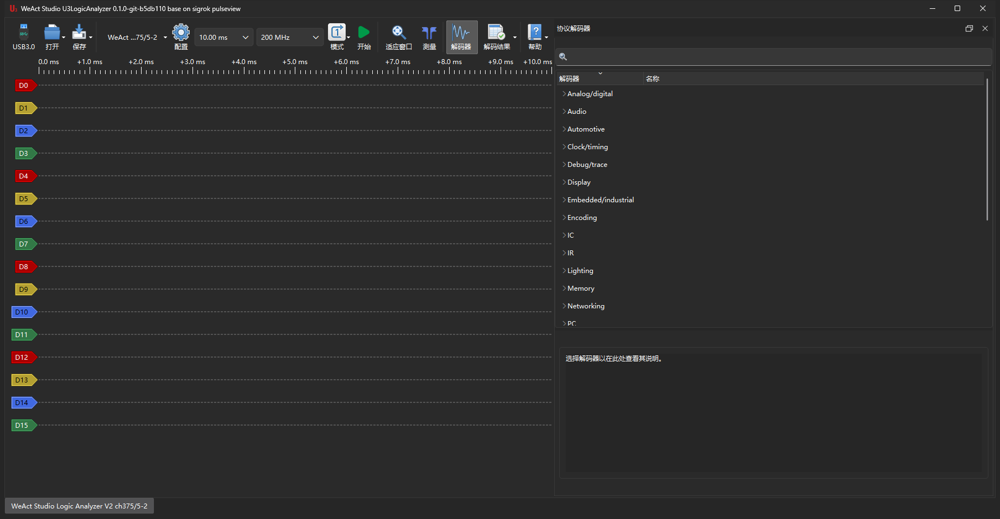
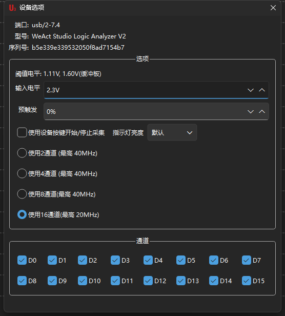
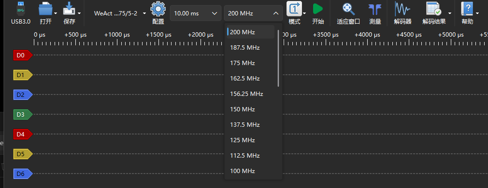
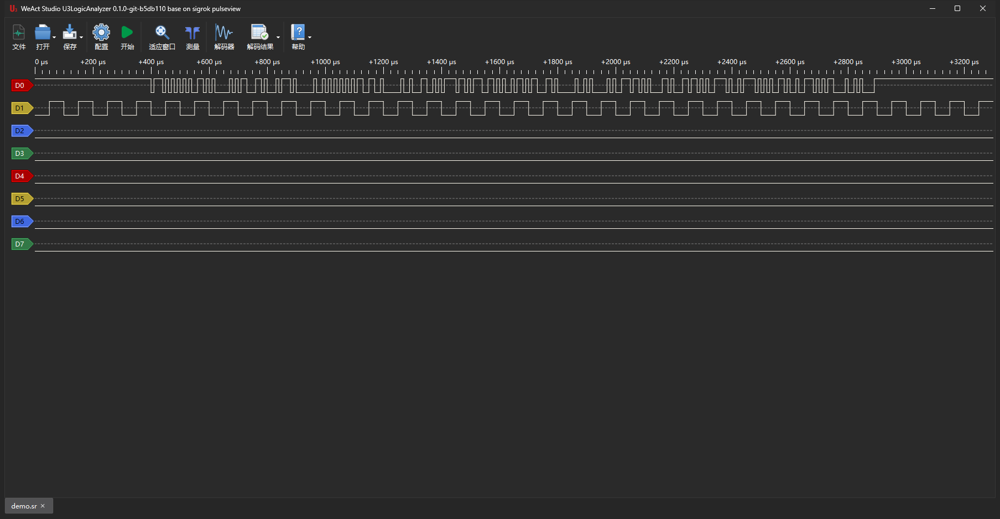

# U3LogicAnalyzer 使用说明

[English](usage.md) · [返回 README](../README_zh.md)

本文说明 U3LogicAnalyzer 的日常操作，包括连接设备、采集、查看波形、添加协议解码与保存导出。



## 界面概览

| 区域 | 说明 |
|---|---|
| 顶部工具栏 | 打开 / 保存 / 设备选择 / 配置 / 采样时长 / 采样率 / 采集模式 / 开始 / 适应窗口 / 测量 / 解码器 / 解码结果 / 导出 |
| 左侧波形区 | 每行一个通道，左端为通道标签（可右键操作），上方为时间轴 |
| 右侧协议解码器 | 搜索框、解码器分类树与所选解码器的说明 |
| 底部标签栏 | 每个标签是一个独立会话（一台设备或一个文件） |
| 状态栏 | 设备名与连接编号，如 `ch375/5-2` |

界面语言跟随系统设置。手动切换方式：帮助 → 设置 → 「语言」，选中后立即生效。

## 连接设备

插上分析仪后，程序会自动扫描设备，设备选择器显示型号与端口，如 `WeAct Studio Logic Analyzer V2 ch375/5-2`。

- **单台设备**：下拉列表中仅有该项，可直接开始采集。
- **多台设备**：下拉列表按端口列出每一台设备；每行右侧提供「在新会话中打开」，可为每台设备各开一个会话并同时采集。
- **插拔**：拔掉正在采集的设备后，该页面显示离线遮罩，无法启动采集；重新插入后自动恢复。采集期间其他设备的插拔不影响正在采集的这台设备。

Windows 上默认使用 CH375DLL 驱动。需要改用 WinUSB 时，在设备管理器中卸载设备并勾选「删除此设备的驱动程序软件」，重新插拔后固件 0.2（`0xAC` 应答中 `sw=0x02`）会自动绑定 WinUSB；旧版固件或 FX2 方案的设备仍需用 Zadig 改绑。

## 设备选项

点工具栏的「配置」（齿轮）按钮打开设备选项面板：



| 项目 | 说明 |
|---|---|
| 阈值电平 | 判定高低电平的门限范围，随「输入电平」联动 |
| 输入电平 | 被测信号的电压，1.0–3.3 V 可选。**必须与实际接入的信号电平一致**：接入 3.3 V 逻辑时选择 3.3 V |
| 预触发 | 采集窗口中留给触发前的比例（0–100%），详见「采集」一节 |
| 通道数 | 2 / 4 / 8 / 16 路。**8 通道**时每个采样点只占 1 字节，同样内存可存双倍采样点 |
| 通道 | 勾选参与采集的通道（仅影响显示与解码，数据仍按通道数打包） |
| 使用设备按键开始/停止采集 | 勾选后可用设备上的 KEY 短按开始、再短按停止采集；长按两秒切换固件槽。需固件 0.2 与上位机 0.2.0.0 及以上 |
| 指示灯亮度 | 暗 / 默认 / 较亮 / 亮 / 最亮五档，默认「默认」。需固件 0.2 与上位机 0.2.0.0 及以上 |

输入电平设置错误会使阈值落在错误位置：设置偏高时正常的高电平被判为低电平，设置偏低时噪声被判为高电平。

> 更改通道数会重置可选采样率表。这是设备侧的规格限制，并非程序缺陷。应先确定通道数，再选择采样率。

## 采样率与采样时长

- **采样率**：USB 3.0 下为 4 MHz 至 200 MHz，共 25 档，档位随链路与通道数变化（USB 2.0 时 16 通道 4 MHz 至 20 MHz，8 通道 4 MHz 至 40 MHz）。
  
- **采样时长**：10 ms 起。软件按 18 GB 数据量定义时长上限（采样点数 = 采样率 × 时长，16 通道每点 2 字节）：200 MHz / 16 通道约 45 s，8 通道约 90 s（实际时长受电脑可用内存限制）。

选型参考：

| 场景 | 采样率 | 时长 |
|---|---|---|
| UART / I²C / SPI 等低速总线 | 不低于波特率或时钟的 5 倍，常用 10–50 MHz | 覆盖所需报文长度 |
| 高速并行总线 | 100–200 MHz | 尽量缩短，注意内存占用 |
| 观察慢速电平变化 | 4–10 MHz | 数秒 |

## 采集

按工具栏的「开始」（或空格键）开始采集，再次按下停止。采集完成后波形自动适应窗口。

- **模式 → 单次（Single）**：采集满设定的采样点数后停止。
- **模式 → 重复（Repeat）**：连续采集，直到手动停止；每轮覆盖上一轮数据。
- **预触发**：设为 50% 时，采集窗口的一半为触发前的样本，其余为触发后的样本。设备没有硬件触发单元，所谓触发是采集窗口内的比例划分，用于观察事件发生前的状态。
- **长采集保护**：数据全部驻留内存。程序在接收数据的过程中检查可用内存，低于 512 MB 时自动停止并提示，已采集的数据保留。需要更长采集时，可减少通道数、降低采样率或缩短时长。

## 波形操作

| 操作 | 方式 |
|---|---|
| 缩放时间轴 | 在波形区滚动鼠标滚轮；或点「适应窗口」回到全览 |
| 左右平移 | 拖动波形，或使用底部滚动条 |
| 测量 | 点「测量」按钮打开两条游标，拖动游标读取时间差与频率 |
| 通道操作 | 右键通道标签：重命名、显示或隐藏、调整高度 |
| 采样点标记 | 视图选项中可显示采样点，用于确认采样密度 |

## 协议解码

点工具栏「解码器」（或按 `D`）打开右侧面板：

1. 在搜索框输入协议名，如 `uart`、`i2c`、`spi`。
2. 展开分类，或直接从搜索结果中双击目标解码器。
3. 在随后弹出的配置窗口中指定通道与参数（如 UART 的 RX 通道、波特率），然后确认。
4. 解码结果作为新的行显示在波形下方；点「解码结果」可切换到单独的列表视图。

一个会话可以叠加多个解码器（例如在 SPI 总线上同时解析 flash 命令与数据）。解码器共 132 个，完整列表见安装目录下的 `decoders` 文件夹（如 `C:\Program Files\WeAct Studio\U3LogicAnalyzer\decoders`）。

解码结果可以导出：工具栏「导出」支持多种文本格式；「导出到新会话」会把当前波形与解码结果复制到新的标签页，便于对照或继续分析。

## 保存与导出

- **保存 / 另存为**：保存为 sigrok 会话文件（`.sr`，zip 容器），包含通道数据与采样率。8 通道采集保存后仍为 8 通道，不会按 16 通道读回。
- **保存选中范围**：只保存当前视口内的样本。
- **保存会话设置**：只保存配置（设备选项、解码器、视图），不含数据。
- **打开**：可通过菜单或命令行：

```bash
./U3LogicAnalyzer capture.sr        # Windows: U3LogicAnalyzer.exe capture.sr
./U3LogicAnalyzer -i capture.sr
```

打开文件时，会话按文件中实际存在的通道建立，通道弹窗只列出这些通道，不会出现空行。



## 多会话与多设备

- 底部标签栏可以同时打开多个会话：每台设备一个，或打开多个 `.sr` 文件。
- 第一个会话不可关闭；打开文件总是新开一个标签。
- 「导出到新会话」把当前结果复制为独立标签，原采集不受影响。
- 关闭最后一个文件标签后，程序会自动补回设备会话。

## 固件升级

帮助菜单 → **固件升级**（FW Update）。

- 升级通过设备 IAP 进行。升级期间该会话的标签不可关闭，避免中断导致设备停留在升级模式。
- 页面显示写入进度，完成后自动重连并重新读取设备信息。
- 升级期间不要拔线；中途失败可以重试，设备仍在 IAP 模式时再次升级即可。

## Agent 配置

安装程序附带两个命令行组件，安装时勾选后才会装入，二者均位于安装目录下。默认目录为 `C:\Program Files\WeAct Studio\U3LogicAnalyzer`，安装时可以更改，下文以 `<安装目录>` 表示实际路径。

| 组件 | 作用 |
|---|---|
| `sigrok-cli.exe` | sigrok 命令行前端，设备扫描、采集与协议解码均由其完成 |
| `sigrok-mcp-server.exe` | 将常用操作封装为工具供 Agent 调用，内部调用 `sigrok-cli` |

> **MCP 并非必需。** 扫描、采集与解码用 `sigrok-cli` 一条命令即可完成；`sigrok-mcp-server` 只是把这些操作封装成工具，供支持 MCP 的客户端调用。安装时只勾选 sigrok-cli，下文命令行用法照常可用。

### 直接调用 sigrok-cli

Agent 只要能执行命令即可使用，无需额外配置；在终端中手动执行也是同样的命令。

按名称调用 `sigrok-cli` 要求安装目录已在 PATH 中。添加方法：系统属性 → 高级 → 环境变量 → 用户变量 `Path`，新增一项，值为实际安装目录（默认 `C:\Program Files\WeAct Studio\U3LogicAnalyzer`）。

不改 PATH 也可以，用完整路径调用。路径含空格，PowerShell 中需使用调用运算符 `&` 并加引号：

```powershell
& "C:\Program Files\WeAct Studio\U3LogicAnalyzer\sigrok-cli.exe" --scan
```

下文命令同理，把行首的 `sigrok-cli` 换成上述完整路径写法，路径按实际安装目录填写。

```bash
sigrok-cli --scan
sigrok-cli -d wch-ch32h417 -c samplerate=4m --samples 2000 -o capture.sr
sigrok-cli -i capture.sr -P uart:rx=D0:baudrate=115200 -A uart=rx-data
```

| 参数 | 说明 |
|---|---|
| `--scan` | 列出设备，返回驱动标识与连接串，形如 `wch-ch32h417:conn=ch375/4-2`（CH375DLL）或 `wch-ch32h417-libusb:conn=usb/2-2.3`（libusb）。端口随 USB 接口变化，更换接口后需重新扫描 |
| `-d` | 指定驱动，标识以 `--scan` 的结果为准：CH375DLL 后端为 `wch-ch32h417`，libusb 后端为 `wch-ch32h417-libusb`；与实际绑定的驱动不符时报 `No devices found.`。接入多台同型号设备时，可用完整连接串指定其中一台 |
| `-c` | 设置采样率，取值须为该驱动支持的档位（4 MHz 至 200 MHz 共 25 档，可用 `--show` 查询）；档位之外的值会报 `Failed to set device option 'samplerate': invalid argument.` |
| `--samples`、`--time` | 前者指定采样点数，后者按毫秒指定采集时长 |
| `-o` | 写出 sigrok 会话文件（`.sr`，zip 容器），与软件「保存」生成的格式相同，可直接打开 |
| `-P`、`-A` | 前者指定解码器及其参数，后者指定要显示的注解 |

扫描结果中另有一台 `demo` 设备，为 sigrok 内置的演示驱动，不对应实际硬件。

命令行可直接交给 Agent 执行，前提是客户端允许执行命令。不必写全命令，说明要做什么即可：

- 「列出当前连接的逻辑分析仪。」
- 「用 50 MHz 采集 1 s，保存到 `D:\cap\uart.sr`。」
- 「把 `uart.sr` 按 UART 解码，RX 接 D0，波特率 115200，输出结果。」

第三条会由 Agent 拼成 `sigrok-cli -i uart.sr -P uart:rx=D0:baudrate=115200 -A uart=rx-data`。解码器有哪些通道与参数，可用 `--show` 查询，也可由 Agent 自行核对。这种方式不受 `SIGROK_TIMEOUT_SECONDS` 约束，超时取决于客户端的命令执行时限；代价是出错时须自行查看 stderr 原文。

### 通过 MCP 服务器调用

服务器把上述操作封装为工具，客户端按同一套格式登记：给出可执行文件、启动参数与环境变量，其中 `command` 指向 `sigrok-mcp-server.exe`，`env` 指明 `sigrok-cli` 的位置。下例中的 `<安装目录>` 需替换为实际路径，JSON 中的反斜杠写作 `\\`：

```json
{
  "mcpServers": {
    "sigrok": {
      "command": "<安装目录>\\sigrok-mcp-server.exe",
      "args": [],
      "env": {
        "SIGROK_CLI_PATH": "<安装目录>\\sigrok-cli.exe",
        "SIGROK_TIMEOUT_SECONDS": "600",
        "SIGROK_WORKING_DIR": "<安装目录>\\workdir"
      }
    }
  }
}
```

| 字段 | 说明 |
|---|---|
| `command` | `sigrok-mcp-server.exe` 的完整路径 |
| `args` | 启动参数，此处为空 |
| `SIGROK_CLI_PATH` | `sigrok-cli.exe` 的完整路径。服务器通过它调用 sigrok，因此不必把安装目录加入 PATH |
| `SIGROK_TIMEOUT_SECONDS` | 单次操作的超时时间（秒），采集时间较长时可增大 |
| `SIGROK_WORKING_DIR` | 存放采集数据等临时文件的工作目录，需事先创建（上例为安装目录下的 `workdir`） |

> 未设置 `SIGROK_CLI_PATH` 时，服务器改为通过 PATH 查找 `sigrok-cli`；两处都找不到时，工具返回
> `sigrok-cli execution failed: exec: "sigrok-cli": executable file not found in %PATH%`。

- `mcpServers` 及 `command`、`args`、`env` 三个键是 MCP 的通用约定；个别客户端顶层键名不同（如 VS Code 使用 `servers`），`disabled` 等附加键按客户端文档填写。
- 配置文件位置：WorkBuddy 为 `%USERPROFILE%\.workbuddy\mcp.json`，保存后需在「连接器 → 自定义连接器」中点「信任」；Claude Desktop 为 `%APPDATA%\Claude\claude_desktop_config.json`；Cursor 为 `%USERPROFILE%\.cursor\mcp.json`；其他客户端见其文档。文件不存在则新建，已存在则将条目合并进 `mcpServers`，不要覆盖其他条目；保存后重启客户端。

配置生效后，在对话框中直接描述需求即可，无需记住工具名。建议按下列顺序上手：

1. **确认设备**：说「列出当前连接的逻辑分析仪」，返回的列表中应出现型号与端口，如 `CH32H417 WeAct Studio Logic Analyzer V2 with 16 channels: D0 … D15`。
2. **短采一次**：说「用 4 MHz 采集 2000 个点，保存为 test.sr」。4 MHz 下 2000 点只有 0.5 ms，用于验证链路；文件默认落在 `SIGROK_WORKING_DIR`，成功后返回写入的文件名，如 `{"file":"test.sr"}`。
3. **正式采集与解码**：说「以 50 MHz 采集 1 s，保存到 `D:\cap\uart.sr`」，或「把 `uart.sr` 按 UART 解码，RX 接 D0，波特率 115200」。解码结果以文本返回。

两点注意：

- 采样率按档位说明（4 MHz、8 MHz、20 MHz 等）；档位之外的值（如 1 MHz）会失败，可让 Agent 先查询驱动支持的档位。
- 采集得到的 `.sr` 文件可直接拖入软件窗口查看。

`sigrok-mcp-server` 提供给 Agent 的工具如下，仅在配置 MCP 后存在。「对应命令行」一列说明每个工具实际执行的动作，便于与前述命令对照，或在失败时定位出错的步骤。

| 工具 | 对应命令行 | 用途 |
|---|---|---|
| `scan_devices` | `--scan` | 扫描设备，返回驱动标识与连接串 |
| `list_supported_hardware`、`show_driver_details` | `-L`、`--show` | 列出驱动，或查看某一驱动的选项与采样率档位 |
| `capture_data` | `-d`、`-c`、`--samples`/`--time`、`-o` | 采集并写入文件 |
| `decode_protocol` | `-i`、`-P`、`-A` | 解码已采集的文件 |
| `list_supported_decoders`、`show_decoder_details` | `-L`、`--show` | 列出解码器，或查看其通道与选项 |
| `list_input_formats`、`list_output_formats` | `-L` | 列出可读写的数据格式 |
| `check_firmware_status`、`show_version` | `-V` | 检查固件文件是否就位，查看组件版本 |
| `get_device_profile`、`serial_query` | — | 用于串口与 SCPI 设备，逻辑分析仪一般用不到 |

## 常见问题

**设备列表中没有设备**
- Windows：确认设备未被其他程序占用；改用 WinUSB 需在设备管理器中卸载设备并勾选「删除此设备的驱动程序软件」。旧版固件或 FX2 方案的设备还需用 Zadig 改绑。
- Linux：`lsusb` 能看到设备但软件中没有，属于权限问题，执行 `sudo ./install_udev_rules.sh` 后重新插拔。

**采集启动后立即停止、采样数为 0**
- 采样率超出当前链路能力，或采样点数过大。降低采样率或缩短时长后重试。
- 设备可能仍被先前的程序占用，拔下后重新连接即可。

**界面语言为英文**
- 界面语言已被手动设置为 English。帮助 → 设置 → 语言，选择「中文」。

**提示可用内存不足 4 GB**
- 程序启动时检查可用内存，低于 4 GB 时提示确认。关闭其他程序后重试，或直接确认继续。
