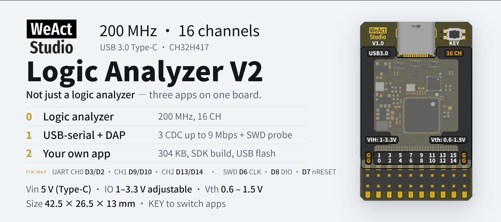

# WeActStudio.LogicAnalyzerV2

[中文](README_zh.md)



200 MHz, 16-channel logic analyzer. CH32H417 dual-core, USB 3.0 Type-C.
Three apps on one board, switched with the key.

## Three apps

| Slot | Flash address | App | Description |
|---|---|---|---|
| 0 | `0x08006000` | Logic analyzer | 200 MHz, 16 channels |
| 1 | `0x08052000` | USB-serial + DAP | 3× CDC up to 9 Mbps + CMSIS-DAP v2 SWD probe |
| 2 | `0x0809E000` | Your own app | 304 KB slot, build with the SDK |

304 KB per slot; the first 24 KB is the IAP (`0x08000000`) and the last 24 KB is the config area
(`0x080EA000`).

## Specifications

| Item | Value |
|---|---|
| Channels | 16 (D0–D15), configurable as 2 / 4 / 8 / 16 |
| Sample rate | USB 3.0: 4–200 MHz; USB 2.0: 4–20 MHz @ 16 ch, 4–40 MHz @ 8 ch |
| Capture length | From 10 ms up; the ceiling is PC memory: about 45 s at 200 MHz / 16 ch, 90 s at 8 ch |
| Input level | 1.0–3.3 V adjustable, threshold 0.6–1.5 V |
| Protocol decoders | 132 (UART / I²C / SPI / CAN and more) |
| Power / interface | USB 3.0 Type-C, Vin 5 V |
| Size | 42.5 × 26.5 × 13 mm (with enclosure) |

## Quick start

1. Install [U3LogicAnalyzer](#downloads), connect the board with a Type-C cable.
2. Set the sample rate and capture length, press **Start** (or the space bar).
3. For decoding, open **Decoders** and pick the protocol.

Firmware update: **Help → FW Update**.

## Pinout

| Terminal | MCU pin | Logic analyzer | USB-serial + DAP |
|---|---|---|---|
| D0 | PD10 | CH0 | — |
| D1 | PD11 | CH1 | — |
| D2 | PD12 | CH2 | USART1 RX |
| D3 | PD13 | CH3 | USART1 TX |
| D4 | PD14 | CH4 | — |
| D5 | PD15 | CH5 | — |
| D6 | PF0 | CH6 | SWCLK |
| D7 | PF1 | CH7 | nRESET |
| D8 | PF2 | CH8 | SWDIO |
| D9 | PC6 | CH9 | USART4 TX |
| D10 | PC7 | CH10 | USART4 RX |
| D11 | PC8 | CH11 | — |
| D12 | PC9 | CH12 | — |
| D13 | PA13 | CH13 | USART3 TX |
| D14 | PA14 | CH14 | USART3 RX |
| D15 | PA15 | CH15 | — |

Loopback jumpers: CH0 D2↔D3, CH1 D9↔D10, CH2 D13↔D14.

On-board signals:

| Signal | Pin | Notes |
|---|---|---|
| KEY | PE1 | Pull-down, high when pressed |
| WS2812 | PC2 | TIM5 CH2 + DMA |
| UART level reference | PA5 | DAC channel 2, 1.0–3.3 V |
| USB | — | Type-C goes to the on-chip USB 3.0 (SuperSpeed) port; no terminals used |

## Key

| Running app | Short press | Hold 2 s, release |
|---|---|---|
| Logic analyzer | — | Next slot |
| USB-serial + DAP | Next IO level: 3.3 → 2.5 → 1.8 → 1.2 V | Next slot |
| Example | Same as above | Next slot |
| IAP | Advance one slot, written immediately | — |

**Entering IAP**: hold KEY at power-on, release once the LED lights up. A slow blink means it is
choosing a slot; press nothing and it stays in upgrade mode (USB ID `1A86:FE17`), where the
upgrade tool can flash firmware. This is the only recovery path.

**Switching apps inside IAP**:

- While the LED blinks, each press advances one slot and is written immediately — survives power loss.
- 3 s of silence after the last press boots that slot; steady LED = decided.

## LED

A single WS2812 (PC2) reports every state by colour, kept dim on purpose:

| State | Display |
|---|---|
| Power-on | Green / blue / red = slot 0 / 1 / 2; slow blink while choosing, steady once set |
| Hold threshold reached | White — release to switch slot |
| Logic analyzer | Breathing while capturing, steady when idle; colour is a mix of the 16 input levels, dark yellow when all low |
| USB-serial + DAP idle | Breathing in the IO level colour: 3.3 V yellow, 2.5 V purple, 1.8 V magenta, 1.2 V red |
| UART traffic | Green = RX, blue = TX, cyan = both, 50 ms flash then back to the level colour |
| DAP traffic | Red/green alternating, back to the level colour 0.5 s after the last command |

## Switching apps

| Method | How |
|---|---|
| Key | Hold 2 s until the LED turns white, then release |
| UART command | Set the baud rate to `2049` / `2050` / `2051` (slot 0 / 1 / 2) |
| Flashing | Writing a slot makes it the boot slot |
| IAP menu | Hold KEY at power-on, release once the LED lights up — it then blinks; each press steps a slot, 3 s idle boots it |

LED right after power-on shows the slot: green = 0, blue = 1, red = 2.

## USB-serial + DAP

The slot 1 app: three USB-to-serial ports plus a CMSIS-DAP v2 probe, usable at the same time.
A short press on the key steps the IO level (3.3 → 2.5 → 1.8 → 1.2 V); it is remembered 3 s later.

| Channel | Terminals | USB interface |
|---|---|---|
| CH0 | D3 TX / D2 RX | MI_00 |
| CH1 | D9 TX / D10 RX | MI_02 |
| CH2 | D13 TX / D14 RX | MI_04 |

COM numbers are not stable — identify a port by its MI_xx interface number, or set the baud rate
to `2034` on any port and read the status report (the line marked `open` is that port). Up to 9 Mbps.

**Escape commands**: set the baud rate to one of these; no data needs to be sent.

| Value | Effect |
|---|---|
| `2010`–`2033` | IO level 1.0–3.3 V in 0.1 V steps, not saved |
| `2034` | Status report: version, three ports, traffic, level, active slot |
| `2035` | Save the current level as the power-on default |
| `2048` | Enter IAP upgrade mode |
| `2049`–`2051` | Switch to slot 0 / 1 / 2 |

**DAP probe**: CMSIS-DAP v2, driver-free over WinUSB, SWD on three pins (D6 CLK / D8 DIO /
D7 nRESET). No JTAG, no SWO.

```bash
pyocd list                                        # shows "WeAct Studio USB UART DAP"
pyocd gdbserver --frequency 8000000 --port 3333
```

With OpenOCD use `interface/cmsis-dap.cfg` and `transport select swd`; use connect-under-reset
when the target firmware is running.

## Downloads

| Software | Purpose | Download |
|---|---|---|
| **U3LogicAnalyzer** | PC software: capture, waveform, decoding (Windows / Linux) | <https://github.com/WeActStudio/WeActStudio.U3LogicAnalyzer/releases> |
| **CH32H417_LogicAnalyzer_Upgrade** | Firmware upgrade tool, GUI + CLI | <https://github.com/WeActStudio/CH32H417_LogicAnalyzer_Upgrade/releases> |
| **WeActStudio.DAPFlasher** | CMSIS-DAP flasher for Cortex-M targets | <https://github.com/WeActStudio/WeActStudio.DAPFlasher/releases> |

## Documentation

| Document | Contents |
|---|---|
| [U3LogicAnalyzer usage](Doc/usage.md) | Full user guide |
| [使用说明](Doc/usage.zh_CN.md) | Chinese version |

## Layout

```
├── Firmware/       # firmware images
├── Slot2_Example/  # slot 2 example app (SDK)
├── Images/         # product images
└── Doc/            # usage guide
```

## Notes

- Samples = rate × duration, 2 bytes per sample at 16 channels (1 at 8), all held in PC memory. The software works from an 18 GB ceiling: 45 s at 200 MHz / 16 ch, 90 s at 8 ch, up to 37 min at 4 MHz. It stops early when memory runs low.
- Other devices on the same USB controller can interrupt a capture — drop to 8 ch @ 200 MHz or 16 ch @ 100 MHz.
- The input level must match the signal actually applied; a wrong setting misplaces the
  threshold and real highs read as low.
- Use the buffer board for single-ended signals to reduce ringing.
