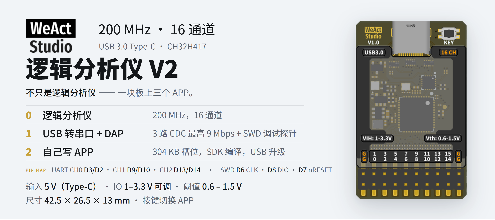

# WeActStudio.LogicAnalyzerV2

[English](README.md)



200 MHz · 16 通道逻辑分析仪，主控 CH32H417 RISC-V 双核，USB 3.0 Type-C 接口；单板内置三个 APP，由按键切换。

## 三个 APP

| 槽位 | 烧录地址 | APP | 说明 |
|---|---|---|---|
| 0 | `0x08006000` | 逻辑分析仪 | 200 MHz，16 通道 |
| 1 | `0x08052000` | USB 转串口 + DAP | 3 路 CDC 最高 9 Mbps + CMSIS-DAP v2 SWD 调试器 |
| 2 | `0x0809E000` | 自己写 APP | 304 KB 槽位，SDK 编译 |

每个槽位 304 KB；最前面 24 KB 为 IAP（`0x08000000`），最后 24 KB 为配置区（`0x080EA000`）。

## 规格

| 项目 | 参数 |
|---|---|
| 通道 | 16 路（D0–D15），可配置为 2 / 4 / 8 / 16 |
| 采样率 | USB 3.0：4–200 MHz；USB 2.0：16 通道 4–20 MHz、8 通道 4–40 MHz |
| 采样时长 | 10 ms 起。软件按 18 GB 数据量定义时长上限：200 MHz / 16 通道约 45 s，8 通道约 90 s（实际时长受电脑可用内存限制） |
| 输入电平 | 1.0–3.3 V 可调，阈值 0.6–1.5 V |
| 协议解码 | 132 个（UART / I²C / SPI / CAN 等） |
| 供电与接口 | USB 3.0 Type-C，Vin 5 V |
| 尺寸 | 42.5 × 26.5 × 13 mm（带外壳） |

## 快速开始

1. 安装 [U3LogicAnalyzer](#软件下载)，用 Type-C 线连接设备。
2. 选择采样率与采样时长，按「开始」（或空格键）开始采集。
3. 需要协议解码时，打开「解码器」并选择协议。

固件升级通过「帮助 → 固件升级」执行。

Windows 默认使用 CH375 驱动。需要改用 WinUSB 时，在设备管理器中卸载设备并勾选「删除此设备的驱动程序软件」，重新插拔后固件 0.2 会自动绑定 WinUSB；旧版固件仍需用 Zadig 改绑。

## 管脚

| 端子 | MCU 引脚 | 逻辑分析仪 | USB 转串口 + DAP |
|---|---|---|---|
| D0 | PD10 | CH0 | — |
| D1 | PD11 | CH1 | — |
| D2 | PD12 | CH2 | USART1 RX |
| D3 | PD13 | CH3 | USART1 TX |
| D4 | PD14 | CH4 | — |
| D5 | PD15 | CH5 | — |
| D6 | PF0 | CH6 | SWCLK |
| D7 | PF1 | CH7 | nRESET |
| D8 | PF2 | CH8 | SWDIO |
| D9 | PC6 | CH9 | USART4 TX |
| D10 | PC7 | CH10 | USART4 RX |
| D11 | PC8 | CH11 | — |
| D12 | PC9 | CH12 | — |
| D13 | PA13 | CH13 | USART3 TX |
| D14 | PA14 | CH14 | USART3 RX |
| D15 | PA15 | CH15 | — |

串口回环跳线：CH0 D2↔D3、CH1 D9↔D10、CH2 D13↔D14。

板内信号：

| 信号 | 引脚 | 说明 |
|---|---|---|
| KEY | PE1 | 内部下拉，按下时为高电平 |
| WS2812 | PC2 | TIM5 CH2 + DMA |
| 串口电平基准 | PA5 | DAC 通道 2，1.0–3.3 V |
| USB | — | Type-C 直接连接芯片的 USB 3.0（SuperSpeed）接口，不占用 D0–D15 端子 |

## 按键

| 当前软件 | 短按 | 长按 2 s 后松开 |
|---|---|---|
| 逻辑分析仪 | 开始 / 停止采集（设备选项中启用后） | 切换到下一个槽位：USB 转串口 + DAP |
| USB 转串口 + DAP | 切换 IO 电平：3.3 → 2.5 → 1.8 → 1.2 V | 切换到下一个槽位：自己写 APP |
| 自己写 APP | 同上 | 切换到下一个槽位：逻辑分析仪 |
| IAP | 前进一个槽位，立即写入配置区 | — |

**进入 IAP**：按住 KEY 上电，指示灯亮起后松开。指示灯慢闪表示正在等待槽位选择，不按按键超时后则停留在升级模式（USB 设备标识为 `1A86:FE17`），可用升级工具烧写固件。这是唯一的恢复通道。

**在 IAP 内切换 APP**：

- 指示灯慢闪时，每按一次前进一个槽位，立即写入配置区，断电后不丢失。
- 最后一次按键后静默 3 s，自动进入该槽位运行；指示灯常亮表示已确定。

## 指示灯

板上只有一颗 WS2812（PC2），所有状态均通过颜色表示。亮度分暗 / 默认 / 较亮 / 亮 / 最亮五档，在上位机设备选项中调节：

| 场景 | 显示 |
|---|---|
| 上电 | 绿 / 蓝 / 红 对应槽 0 / 1 / 2；选择槽位时以同色慢闪，确定后常亮 |
| 长按到点 | 白色，松开即切换槽位 |
| 逻辑分析仪 | 采集时呼吸，空闲时常亮；颜色由 16 路输入电平混合，全部为低电平时呈暗黄 |
| 串口 + DAP 空闲 | 呼吸，颜色表示 IO 电平：3.3 V 亮黄、2.5 V 紫、1.8 V 品红、1.2 V 红 |
| 串口收发 | 绿表示接收、蓝表示发送、青表示同时收发，闪烁 50 ms 后恢复电平色 |
| DAP 通信 | 红绿交替闪烁，停止通信 0.5 s 后恢复电平色 |

## 软件切换

| 方式 | 操作 |
|---|---|
| 按键 | 长按 2 s，指示灯变为白色后松开 |
| 串口命令 | 把波特率设为 `2049` / `2050` / `2051`（对应槽 0 / 1 / 2） |
| 烧录 | 写入哪个槽位，启动时即运行该槽位 |
| IAP 选槽 | 按住 KEY 上电，指示灯亮起后松开，随后进入慢闪的选槽状态；每按一次前进一个槽位，停止操作 3 s 后进入该槽位 |

上电时的指示灯颜色即当前槽位：绿为槽 0、蓝为槽 1、红为槽 2。

## USB 转串口 + DAP

槽 1 的 APP 提供 3 路 USB 转串口和一个 CMSIS-DAP v2 调试器，两者可同时使用。短按 KEY 切换 IO 电平（3.3 → 2.5 → 1.8 → 1.2 V），停止操作 3 s 后自动保存。

| 通道 | 端子 | USB 接口 |
|---|---|---|
| CH0 | D3 TX / D2 RX | MI_00 |
| CH1 | D9 TX / D10 RX | MI_02 |
| CH2 | D13 TX / D14 RX | MI_04 |

COM 端口号顺序不固定，可根据设备属性中的「接口」MI_xx 判断所属通道，或在任一端口把波特率设为 `2034` 读取状态报告，标注为 `open` 的一项即为该端口。波特率最高 9 Mbps。

**转义命令**：把**波特率**设为下列数值即可触发，无需发送任何数据。

| 值 | 作用 |
|---|---|
| `2010`–`2033` | 连续设置 IO 电平 1.0–3.3 V，步进 0.1 V，不保存 |
| `2034` | 输出状态报告：版本、三路开关与波特率、流量、电平、当前槽位 |
| `2035` | 把当前电平保存为开机默认值 |
| `2048` | 进入 IAP 升级模式 |
| `2049`–`2051` | 切换到槽 0 / 1 / 2 |

**DAP**：CMSIS-DAP v2 调试器，WinUSB 免驱，SWD 三线（D6 CLK / D8 DIO / D7 nRESET），不支持 JTAG 与 SWO。

```bash
pyocd list                                        # shows "WeAct Studio USB UART DAP"
pyocd gdbserver --frequency 8000000 --port 3333
```

OpenOCD 使用 `interface/cmsis-dap.cfg` 与 `transport select swd`；目标固件正在运行时，需使用 connect-under-reset 才能连接。

**Keil MDK 5.36** 自带的驱动版本过旧，无法识别 CMSIS-DAP v2 调试器，µVision 中因此不显示该设备；ARM 在后续 MDK 版本中修复了此问题。**以下两种方式任选其一：**

| 修复方式 | 做法 |
|---|---|
| 替换 DLL | 先备份 Keil 安装目录下的 `ARM\BIN`，再用 `Firmware/dll_fix_keil.zip` 中的 `CMSIS_DAP.dll`、`CMSIS_AGDI.dll`、`CMSIS_AGDI_V8M.dll` 覆盖同名文件，然后重启 µVision。 |
| 升级槽 1 | 烧写 `Firmware/SLOT1_CH32H417_USB2UART_DAP_APP_fix_keil5.36.bin`。唯一的可见差异是 USB 产品名改为 `WeAct Studio CMSIS-DAP`，5.36 即可识别；`pyocd list` 与设备管理器中显示的名称也随之改变。 |

随后在工程选项中选择 **CMSIS-DAP Debugger**，Port 选择 **SW**。

## 软件下载

| 软件 | 用途 | 下载 |
|---|---|---|
| **U3LogicAnalyzer** | 上位机软件：采集、波形、协议解码（Windows / Linux） | <https://github.com/WeActStudio/WeActStudio.U3LogicAnalyzer/releases> |
| **CH32H417_LogicAnalyzer_Upgrade** | 固件升级工具，提供图形界面与命令行 | <https://github.com/WeActStudio/CH32H417_LogicAnalyzer_Upgrade/releases> |
| **WeActStudio.DAPFlasher** | CMSIS-DAP 调试器烧录工具 | <https://github.com/WeActStudio/WeActStudio.DAPFlasher/releases> |

## 文档

| 文档 | 内容 |
|---|---|
| [U3LogicAnalyzer 使用说明](Doc/usage.zh_CN.md) | 完整使用手册 |
| [U3LogicAnalyzer Usage](Doc/usage.md) | 英文版 |
| [3D 模型（STEP）](Hardware/WeAct-LogicAnalyzerV2_v10%203D.step) | 结构模型，可用 CAD 软件打开 |

## 目录

```
├── Firmware/       # 固件镜像 + Keil 5.36 的 DLL 修复包
├── Slot2_Example/  # 槽 2 示例工程（SDK）
├── Hardware/       # 3D 模型（STEP）
├── Images/         # 产品图
└── Doc/            # 使用说明
```

## 注意

- 采样点数 = 采样率 × 时长，16 通道每点 2 字节（8 通道 1 字节），数据全部驻留在电脑内存中。软件按 18 GB 数据量换算上限：200 MHz / 16 通道为 45 s，8 通道为 90 s，4 MHz 可达 37 分钟。可用内存不足时，上位机会提前停止采集。
- 同一 USB 控制器下的其他设备频繁插拔、打开关闭可能打断采集，可降低至 8 通道 200 MHz 或 16 通道 100 MHz。
- 输入电平必须与实际接入的信号一致；设置错误会使阈值落在错误位置，正常的高电平被判为低电平。

```
/*---------------------------------------
- WeAct Studio Official Link
- taobao: WeActStudio.taobao.com
- aliexpress 1: WeActStudio.aliexpress.com
- aliexpress 2: WeActStudioOne.aliexpress.com
- github: github.com/WeActStudio
- gitee: gitee.com/WeActStudio
- blog: blog.weactstudio.com
---------------------------------------*/
```